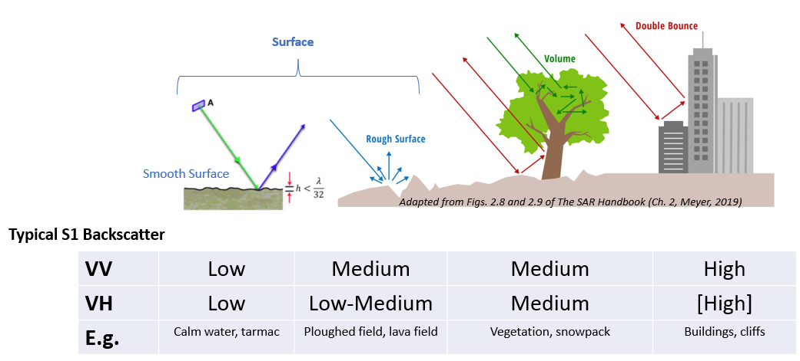
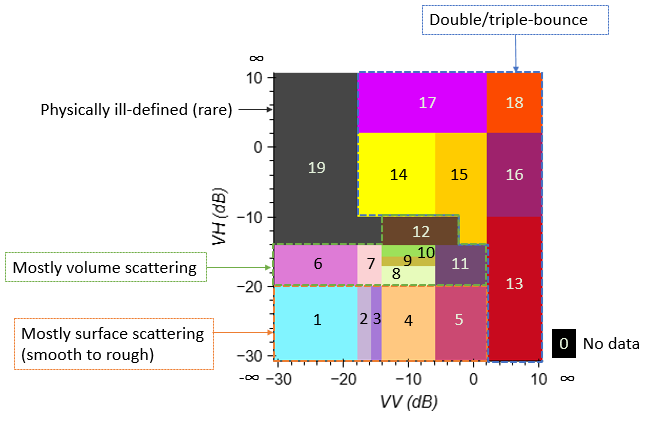
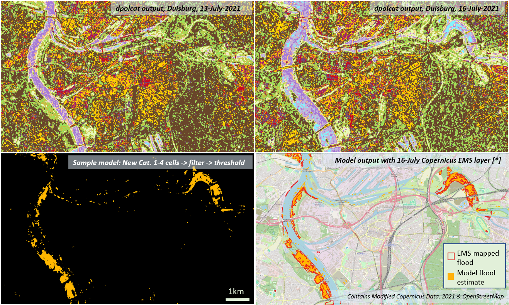
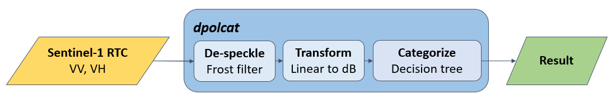
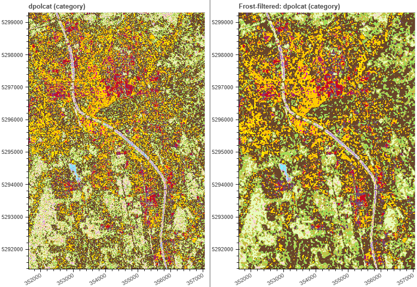
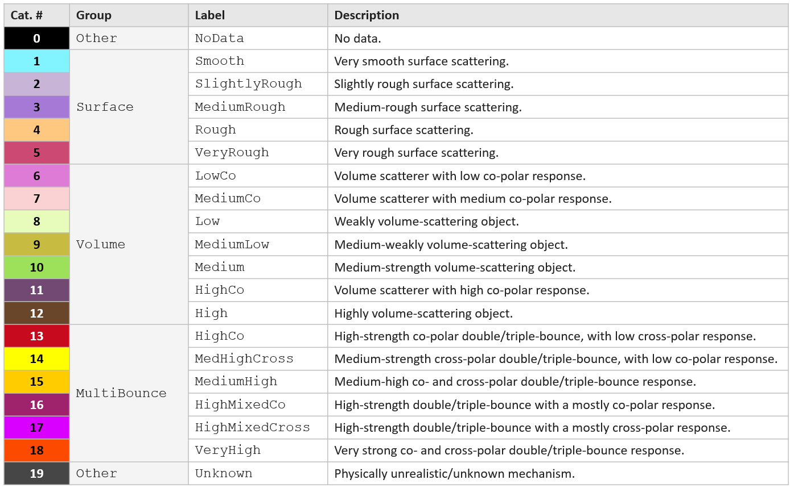
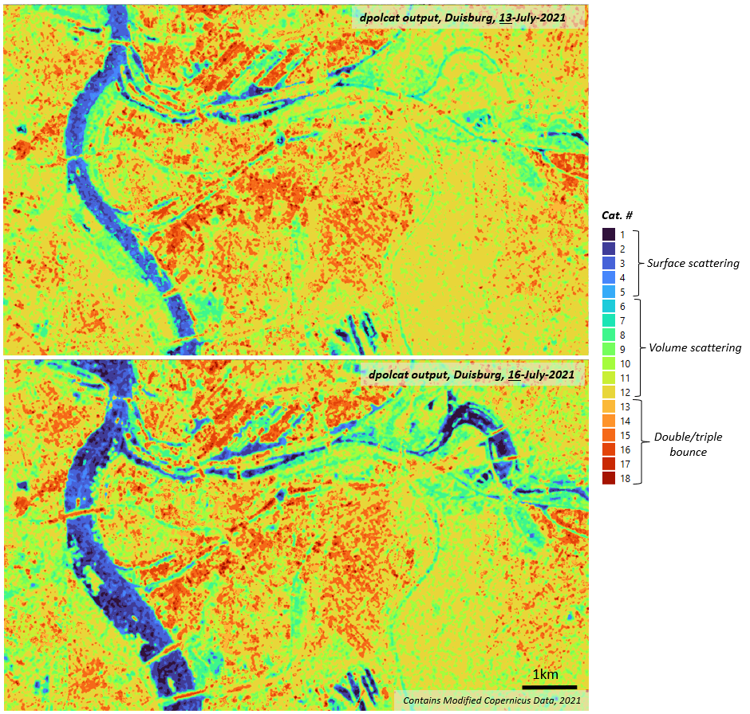
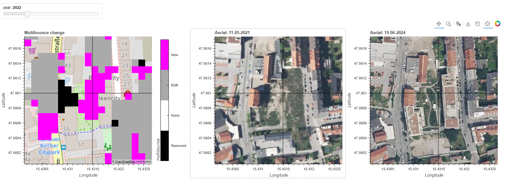

# dpolcat

*dpolcat* is a tool for the semantic categorization of dual-polarimetric synthetic aperture radar (SAR) imagery. (Specifically, Sentinel-1 with VV and VH polarizations at present.)

It is inspired by Dr. Andrea Baraldi's [Satellite Image Automatic Mapper™](http://siam.andreabaraldi.com/) (SIAM™) concept of *spectral categories* for optical data, the [Sen2Cube](https://www.sen2cube.at/) project, and Luuk van der Meer's [Semantique](https://github.com/zgis/semantique).

Status: This is a research project with occasional updates.

There's a pre-release package on pypi with the core functionality: https://pypi.org/project/dpolcat/

## Overview

Different objects on the earth's surface scatter the microwave signals that radar satellites emit and receive, in different ways.

We bin the backscatter received in the same- (VV) and cross-polarized (VH) signals into distinct *polarimetric categories* that give a hint at what's on the ground.

We can then make inferences based on how these categories are distributed in an area, or change over time.

[*]: [Copernicus EMSR517](https://emergency.copernicus.eu/mapping/ems-product-component/EMSR517_AOI06_DEL_MONIT01_r1_RTP03/1)

This is implemented in a Python library that performs scaling, speckle-filtering, and then categorization, using a decision-tree algorithm.

It uses the [Numba](https://numba.pydata.org/) just-in-time compiler to increase performance, and [Dask](https://www.dask.org) for parallelization.

### Colour palette

A note on the colour palette. The choices **loosely** follow these rules:
- Natural phenomena map to pale colours.
- Man-made phenonema map to bright colours.  

Sometimes the colours resemble certain land cover types. This may not be coincidence. BUT, there's no one-to-one mapping of land cover type to category/colour.

### Speckle filtering

A speckle filter (per Frost et al., 1982) is provided as an optional (but recommended) pre-processing step.

### Semantic API

For modelling in a more semantic manner, i.e., using textual rather than category indices, a few helper classes have been provided. These can be accessed through `dpolcat.modelling`, and their usage is shown in the demo notebooks.

### Category numbering

The numbering/indices of the categories has a property with an interesting side effect: they loosely increase in order of  magnitude of the VV+VH vector they represent. This means modelling and visualization can sometimes use the category index alone as an input. For example, below is another way of visualizing the pre-and post-flood scenes from earlier.

### Related work

This work has a number of things in common with the polarimetric decomposition and 'scattering behaviour zones' described by Cloude and Pottier, 1997. The key differences are that *dpolcat* works on dual-polarimetric, rather than fully-polarimetric acquisitions, and it doesn't consider the phase signal components. As it doesn't require a decomposition step, processing is significantly faster.

For further background, see the related [master thesis](https://eplus.uni-salzburg.at/Abschlussarbeiten/content/titleinfo/11624947).

## Environment

Launch marimo notebooks via either:
- Pixi - run `pixi run marimo edit` (a browser opens automatically).
- Docker - use locally with, e.g., `docker compose up` and browse to localhost:8080. ⚠️ This opens a notebook server without authentication, make sure to be behind a properly configured firewall.

## Contents

Some of the main files and folders.

    '🟢' indicates the file can be run as a marimo notebook.

### 📁 `src/dpolcat`

The main components of the *dpolcat* package.

#### 📄 `core.py`

The heart of *dpolcat*, containing the algorithms/functions for performing polarimetric categorization.

#### 📄🟢 `processor.py`

A parameterized notebook containing a batch processing workflow.

#### 📄 `modelling.py`

Submodule `dpolcat.modelling` which contains helpers for creating semantic models with categories.

#### 📄🟢 `utils.py`

Contains reusable utility/helper functions etc. for working with *dpolcat* in various settings.

#### 📄 `pc_rio_driver.py`

A utility class for [odc-stac](https://odc-stac.readthedocs.io/en/latest/intro.html) which takes care of Planetary Computer asset signing.

#### 📄 `fast_frost.py`

A numba-based implementation of a Frost speckle filter.

### 📁 `demo`

#### 📄🟢 `demo_01_intro.py`

An introduction to *dpolcat*.

#### 📄🟢 `demo_02_flood.py`

Demonstration of a simple flood modelling and mapping workflow using *dpolcat*.

#### 📄🟢 `demo_03_batch_processing.py`

A batch processing/datacube-writing demonstration.

#### 📄🟢 `demo_04_urban.py`

Demonstration of some simple urban change modelling and mapping.  

### 📁 `gis`

#### 📁 `duisburg`

Supplementary folder for the flood mapping demo notebook, containing a QGIS project and associated data for accuracy assessment.

#### 📁 `graz`

Supplementary folder inc. QGIS project for the Graz-related demos.

### 📁 `experiments`

#### 📄🟢 `inverness_*.py`

Exploratory analysis of SAR signals and dpolcat processing in a study area of Inverness, Scotland.

### 📁 `scripts`

#### 📄🟢 `graz_prep.py`

Builds the full-size datacube for the Graz urban change demo.

### 📁 `archive`

Some things based on earlier versions, which may be useful for additional context.

#### 📄 `media/EARSeL2024-Slides.pdf`

Slides presented at the 43rd EARSeL Symposium in Manchester, UK, 17-June-2024. (Based on an older version.)

#### 📄 `media/poster.pdf`

A simple poster about the project presented internally (based on an even older version).

## Contributing

Please discuss problems or suggestions via an issue. Pull requests are restricted to contributors only, for now.

## Credits

Sentinel imagery: Contains modified Copernicus Sentinel data, processed by ESA and others.

Flood reference: [Copernicus Emergency Mapping EMSR517](https://emergency.copernicus.eu/mapping/ems-product-component/EMSR517_AOI06_DEL_MONIT01_r1_RTP03/1)

Graz aerial imagery: [Land Steiermark](https://www.landesentwicklung.steiermark.at/cms/beitrag/12866797/142970647/)

## Authors

Created by Luke McQuade at [Z_GIS](https://www.plus.ac.at/geoinformatik/?lang=en), originally as part of the the Applied Geoinformatics MSc programme.

## AI usage policy

Use sparingly (the author(s) will read all lines of code). Do not use for human-readable text, e.g., documentation, code comments, PR descriptions, commit message. Where a model is the main author of a function or more, add a comment naming the model and version.

## Acknowledgements

I would like to greatly thank the members of the [EO Analytics Group](https://www.plus.ac.at/geoinformatik/research/research-areas/eo-analytics/?lang=en) and Dr. Zhara Dabiri of the [Risk, Hazard and Climate Lab](https://www.plus.ac.at/geoinformatik/research/research-areas/risk-hazard-climate/?lang=en) for their ideas and support, and Assoc. Prof. Hermann Klug and Dr. Bernhard Zagel for their instruction and continuous feedback.

Further developments have been part of my [master thesis](https://eplus.uni-salzburg.at/Abschlussarbeiten/content/titleinfo/11624947), supervised by Prof. Dr. Dirk Tiede, Dr. Martin Sudmanns, and Dr. Zhara Dabiri.  

## References

Augustin, H., Sudmanns, M., Tiede, D., Lang, S., & Baraldi, A.. Semantic Earth observation data cubes. Data, 4(3), 102 (2019). https://doi.org/10.3390/data4030102

Baraldi, A., Humber, M.L., Tiede, D., Lang, S.. GEO-CEOS stage 4 validation of the Satellite Image Automatic Mapper lightweight computer program for ESA Earth observation level 2 product generation – Part 2: Validation. Cogent Geosci. 4, 1–52 (2018).  
https://doi.org/10.1080/23312041.2018.1467254

Meyer, F.. Ch. 2, The SAR Handbook: Comprehensive Methodologies for Forest Monitoring and Biomass Estimation (2019). https://doi.org/10.25966/nr2c-s697

Frost, Victor S., Josephine Abbott Stiles, K. S. Shanmugan, and Julian C. Holtzman. 'A Model for Radar Images and Its Application to Adaptive Digital Filtering of Multiplicative Noise'. IEEE Transactions on Pattern Analysis and Machine Intelligence PAMI-4, no. 2 (March 1982): 15766. https://doi.org/10.1109/TPAMI.1982.4767223

Cloude, S. R., and E. Pottier. An Entropy Based Classification Scheme for Land Applications of Polarimetric SAR. IEEE Transactions on Geoscience and Remote Sensing 35, no. 1 (1997): 68–78. https://doi.org/10.1109/36.551935
